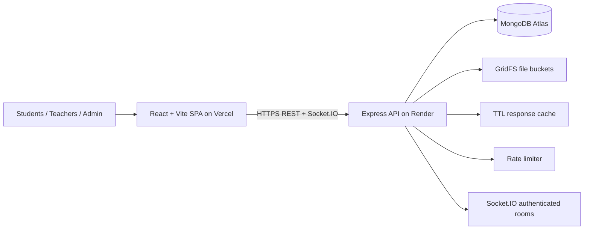

# CampusCare Architecture

## Advanced features and justification
1. **Rate limiting** protects login and public/contact endpoints from repeated abusive requests. Verify by exceeding the configured limit and observing HTTP 429.
2. **Real-time communication (Socket.IO)** delivers community post events without refreshing. Socket handshakes are authenticated and room joins are checked against community membership.
3. **File uploads with GridFS** stores Lost & Found images and community documents in MongoDB rather than ephemeral Render disk.
4. **TTL caching** caches frequently-read community listings for 20 seconds, reports HIT/MISS in the response, and invalidates after community writes. Cache metrics: `GET /api/cache-metrics`.

## Data relationships
- User owns LostFound records, Reports, Community ownership, Exam seats and Exam duties.
- Community embeds posts; posts reference their author.
- ExamSeat references Exam and User; ExamDuty references Exam and User; ExamRequest references Exam and User.
- LostFoundClaim references LostFound and User.

## SaaS tenancy
CampusCare is designed as a multi-tenant platform. A global Platform Owner provisions campus tenants; campus Admins administer only their own tenant. Each tenant-owned collection is scoped by immutable `tenantId`, resolved from the campus slug/subdomain or registered custom domain. See `Multi-Tenant-SaaS.md` for provisioning and migration.
